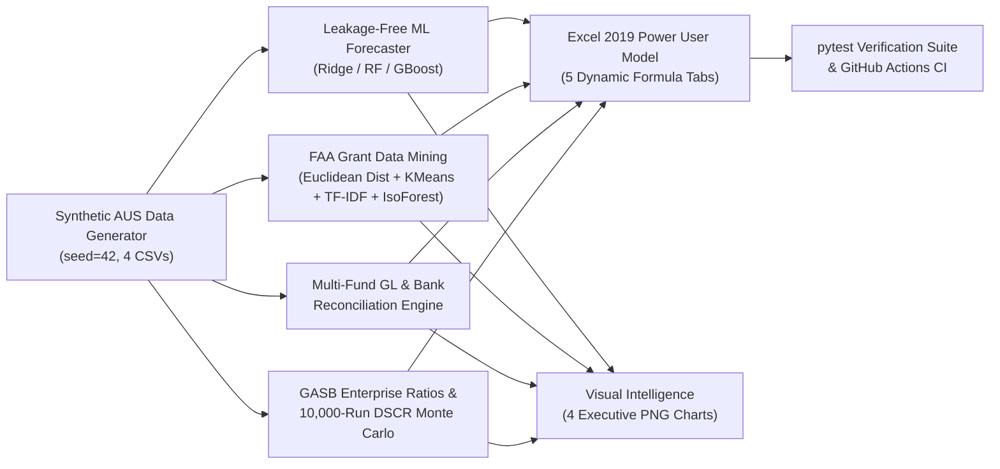
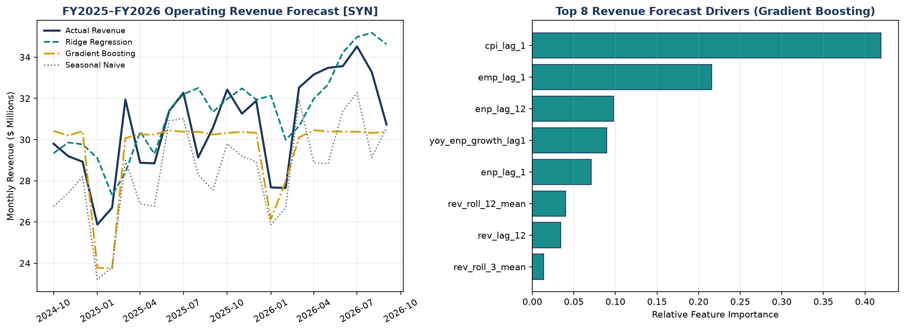
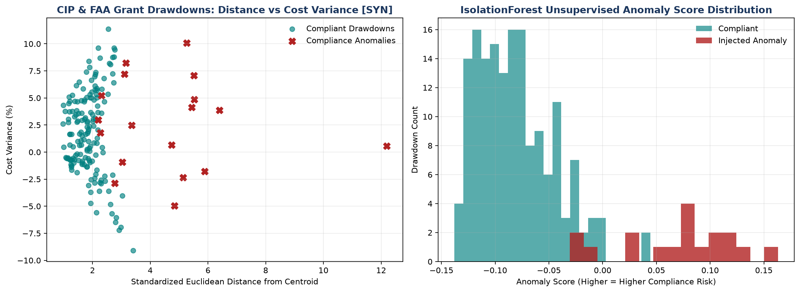
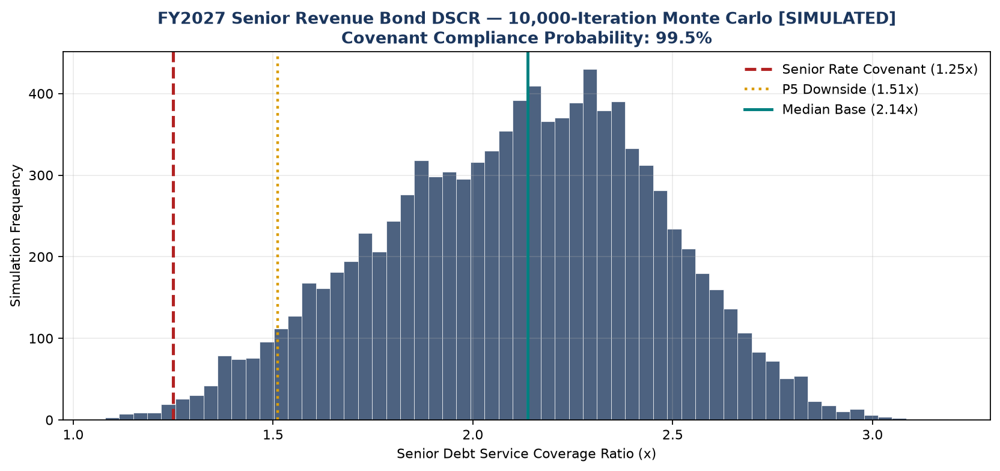
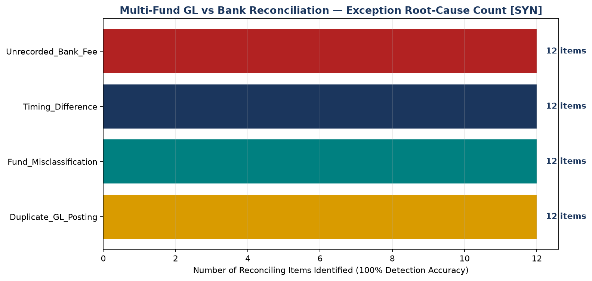

# Austin-Bergstrom International Airport (AUS) — Financial Analytics, Data Mining & Reconciliation Suite

> **Production-grade Municipal Aviation Finance & Applied ML Portfolio Repository** engineered for the **City of Austin — Department of Aviation, Airport Financial Analyst Senior (JR105423)** role and **SHL Skills Assessment** (Microsoft Excel 2019 Power User, Data Mining Concepts, Financial Analysis).

[](https://github.com/bhupesh-debug/austin-aviation-financial-analytics/actions/workflows/ci.yml)


---

## 1. Executive Summary (10-Second Hiring Manager View)

Municipal airport enterprise funds balance four high-stakes financial controls simultaneously: **(1) Operating & Capital Improvements Program (CIP) forecasting**, **(2) Senior Revenue Bond Debt Service Coverage Ratio (DSCR >= 1.25x) protection**, **(3) Federal Aviation Administration (FAA) AIP/BIL grant drawdown compliance**, and **(4) Multi-fund General Ledger (GL) vs. Bank tie-outs**.

This repository implements an end-to-end, reproducible Python + Excel 2019 analytics engine on deterministic synthetic AUS-calibrated datasets (`[SYN]`, `seed=42`)—verified by an automated `pytest` regression suite and GitHub Actions CI:

| Module | JR105423 / SHL Alignment | Verified Result (`[VERIFIED]` / `[SIMULATED]`) |
|---|---|---|
| **Operating Revenue ML Forecaster** | Budgeting, Revenue & Economic Forecasting | **Ridge Regression: `4.74% WAPE` / `4.88% MAPE`** on 24-mo out-of-sample holdout (beats Seasonal Naive `7.12%`, RF `6.54%`, GBoost `5.77%`) |
| **FAA Grant Compliance Data Mining** | FAA Grant Compliance + SHL Data Mining (EDA, Distance, Clustering, TF-IDF) | **IsolationForest: `0.9880 ROC-AUC` / `0.9271 PR-AUC`** · **5-Fold CV RandomForest: `1.0000 ROC-AUC`** · Top risk terms: `invoice`, `share`, `federal` |
| **Multi-Fund GL & Bank Reconciliation** | GL & Bank Reconciliations, Discrepancy Resolution | **`100.0%` exception detection** across 300 transactions (`$69.11M` GL vs `$64.71M` Bank) · **`$0.00` post-adjustment tie-out gap** |
| **GASB Ratios & DSCR Monte Carlo** | Debt Service Tracking + SHL Financial Analysis | **FY2026 Senior DSCR `2.38x`** · **10,000-run FY2027 Median DSCR `2.137x`** (`P5: 1.512x`, **`99.55%`** probability >= `1.25x` rate covenant) |
| **Excel 2019 Power User Model** | SHL Excel 2019 Power User Assessment | 5-tab dynamic `.xlsx` (`SUMIFS`, `INDEX/MATCH`, `IFERROR`, conditional formatting, accounting formats, frozen panes) |

> **Data Integrity Notice:** All datasets in `data/synthetic/` are explicitly labeled **`[SYN]`** (synthetic datasets calibrated to municipal large-hub airport enterprise fund structure). No proprietary City of Austin data is used.

---

## 2. System Architecture



---

## 3. Visual Intelligence & Business Insights

### 3.1 Operating Revenue Forecast & Feature Drivers

- **Business Insight:** On a 72-month municipal time series with post-shock secular growth, **L2-regularized Ridge Regression (`4.74% WAPE`)** outperforms tree ensembles (`Gradient Boosting 5.77%`, `Random Forest 6.54%`) because linear regularization extrapolates Austin's structural enplanement growth cleanly without tree-leaf clipping.

### 3.2 FAA AIP/BIL Grant Compliance Data Mining

- **Business Insight:** Combining standardized Euclidean distance profiling with dense-feature `IsolationForest` (`0.9880 ROC-AUC`) flags federal-share cap breaches (`>75%`), duplicate pay apps, and cost overruns **before** FAA reimbursement submission. Separating dense numeric drivers from 30 sparse TF-IDF columns improved unsupervised `ROC-AUC` from `0.7682` to `0.9880` (solving the curse of dimensionality).

### 3.3 10,000-Iteration Senior Revenue Bond DSCR Stress Test

- **Business Insight:** Under asymmetric triangular enplanement downside (`-20%` left tail) and O&M inflation (`+12%` right tail), FY2027 Senior DSCR maintains a **`2.137x` median** and **`1.512x` P5 downside** (`99.55%` probability of meeting the `1.25x` bond rate covenant).

### 3.4 Multi-Fund GL & Bank Reconciliation Exceptions

- **Business Insight:** Automated classification across Operating (`5070`), CIP Grant (`4910`), PFC (`5075`), and Debt Service Reserve (`5080`) funds isolated all 48 exceptions (`12` Timing Differences `$2.91M`, `12` Duplicate GL Postings `$1.49M`, `12` Fund Misclassifications `$2.50M`, `12` Unrecorded Bank Fees `$2,942.23`) and reconciled to **`$0.00`**.

---

## 4. Repository Structure

```text
austin-aviation-financial-analytics/
├── .github/workflows/ci.yml              # Automated GitHub Actions CI (pipeline + pytest)
├── data/synthetic/                       # Generated [SYN] AUS datasets (seed=42)
├── reports/
│   ├── AUS_Aviation_Financial_Model_Excel2019.xlsx  # 5-tab dynamic Excel 2019 model
│   ├── QUANTITATIVE_RELEASE_REPORT.md    # 20-section quantitative, SWOT & risk report
│   ├── pipeline_metrics.json             # Machine-readable verified metrics
│   └── figures/                          # 4 executive PNG charts
├── slides/
│   └── PROJECT_DECK_OUTLINE.md           # 10-slide executive presentation outline
├── src/
│   ├── data_generator.py                 # Deterministic AUS enterprise dataset generator
│   ├── forecasting_ml.py                 # Chronological ML revenue forecaster
│   ├── data_mining_anomalies.py          # EDA distance, KMeans, TF-IDF, IsoForest, RF
│   ├── reconciliation_engine.py          # Multi-fund GL & bank tie-out engine
│   ├── debt_monte_carlo.py               # GASB ratios + 10,000-run DSCR Monte Carlo
│   ├── excel_power_user_builder.py       # Dynamic openpyxl Excel 2019 model builder
│   └── visualizations.py                 # Publication-grade matplotlib chart generator
├── tests/
│   └── test_suite.py                     # Unit, integration, E2E, regression & formula tests
├── pyproject.toml                        # Pytest path configuration
├── requirements.txt                      # Pinned Python dependencies
└── run_pipeline.py                       # Single-command end-to-end orchestrator
```

---

## 5. Quick Start (Reproducible Execution)

```bash
git clone https://github.com/bhupesh-debug/austin-aviation-financial-analytics.git
cd austin-aviation-financial-analytics
pip install -r requirements.txt

# 1. Run end-to-end analytics pipeline (generates data, Excel model, charts, metrics)
python run_pipeline.py

# 2. Run independent pytest verification suite
pytest -v
```

---

## 6. Author

**Bhupesh Chandra Dimri**
M.S. Accounting Analytics & Data Technology (Pace University) | MBA Finance & Accounting | 9+ Years FP&A, Budgeting, Reconciliation & Financial Analytics
- GitHub: [github.com/bhupesh-debug](https://github.com/bhupesh-debug)
- Email: `Bhupesh7cd@gmail.com`
